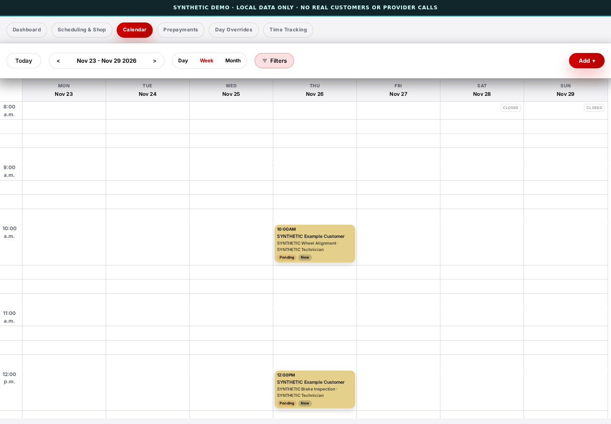
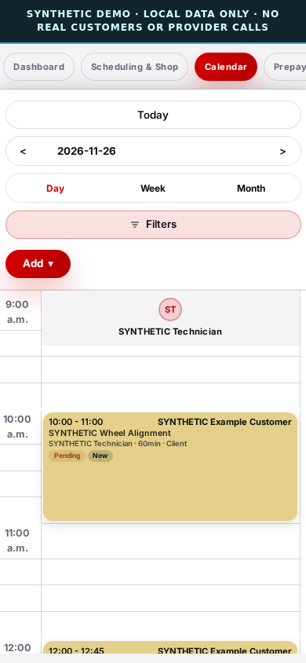
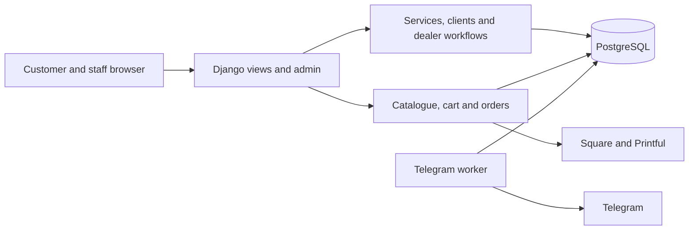

<p align="center">
  
  
</p>

<p align="center">
  <a href="docs/DEMO.md">Demo</a> ·
  <a href="docs/ENGINEERING_CASE_STUDY.md">Engineering</a> ·
  <a href="#capabilities">Capabilities</a> ·
  <a href="#architecture">Architecture</a> ·
  <a href="#local-development">Local development</a> ·
  <a href="#source-map">Source map</a>
</p>

BGM brings automotive service booking, customer relationships, dealer applications
and product sales into one Django application. Customers use a service and shopping
portal; staff manage the underlying appointments, orders, content and communication.

## In the application

| Staff calendar · desktop | Day calendar · mobile |
| --- | --- |
|  |  |

**Synthetic local demo.** [Watch the workflow and run it](docs/DEMO.md) ·
[Read the engineering case study](docs/ENGINEERING_CASE_STUDY.md).
Real source views, a new isolated database and example records only; no payment or notification providers are called.

## Capabilities

- **Service operations:** service catalogues, staff availability, appointment booking,
  rescheduling, cancellation and payment records.
- **Customer and dealer workflows:** role-oriented dashboards, customer profiles,
  documents, order history and dealer applications with tiered pricing.
- **Commerce:** vehicle-fitment filters, product options, session carts, pickup and
  shipping checkout, discounts and order management.
- **Store integrations:** Square payment configuration and Printful merchandise,
  shipping and webhook support.
- **Back office:** Django admin workspaces, editable site copy, project journals,
  email campaigns and lead-review tools.
- **Operations messaging:** a separate Telegram worker, recipient controls,
  reminders, delivery logs and daily digests.

## Architecture



| Layer | Implementation |
| --- | --- |
| Application | Python, Django 5.2, Django templates |
| Data | PostgreSQL, Django ORM and migrations |
| Back office | Django admin, Jazzmin, autocomplete widgets |
| Integrations | Square, Printful, Telegram, configurable email and S3 storage |
| Runtime | Gunicorn, WhiteNoise, optional Redis-backed lead controls |

## Local development

Use a fresh checkout and an empty local PostgreSQL database. Set `SECRET_KEY` and
`DATABASE_URL` to your own local values before running Django; see the complete
[development guide](docs/DEVELOPMENT.md). Keep external providers unconfigured until
you intentionally test their integrations.

```bash
python3 -m venv .venv
source .venv/bin/activate
python -m pip install -r requirements.txt
# Configure the local environment and empty PostgreSQL database first.
python manage.py migrate
python manage.py createsuperuser
python manage.py runserver 127.0.0.1:8000
```

Open [the staff admin](http://127.0.0.1:8000/admin/) or
[customer login](http://127.0.0.1:8000/accounts/login/). Create your own account;
there are no shared demonstration credentials in this documentation.

These commands match the repository entry points and requirements. A separate
[verified synthetic demo](docs/DEMO.md) migrates a new bounded PostgreSQL instance
and renders the actual staff workspace. Payment, messaging and fulfilment providers
were disabled and were not verified by that demonstration.

## Source map

| Area | Code and documentation |
| --- | --- |
| Project settings and routes | [booking/](booking/) |
| Accounts and customer portal | [accounts/](accounts/) |
| Services, CRM and staff workflows | [core/](core/) |
| Catalogue, cart and orders | [store/](store/) |
| Telegram worker | [notifications/](notifications/) · [bot guide](docs/telegram-notifications.md) |
| Merchandise and shipping | [Printful guide](docs/merch_shipping_and_printful.md) |
| Setup, data entry and customization | [Development](docs/DEVELOPMENT.md) |

## Scope and project terms

Use a dedicated local database and configuration when working with a checkout.
Payment and messaging capabilities depend on their own configuration and external
services. Configure uploads and backups separately for any deployment.

The existing project notice provides this code for internal use and educational
purposes. Third-party assets retain their respective terms. This presentation refresh
does not introduce a new licence.
