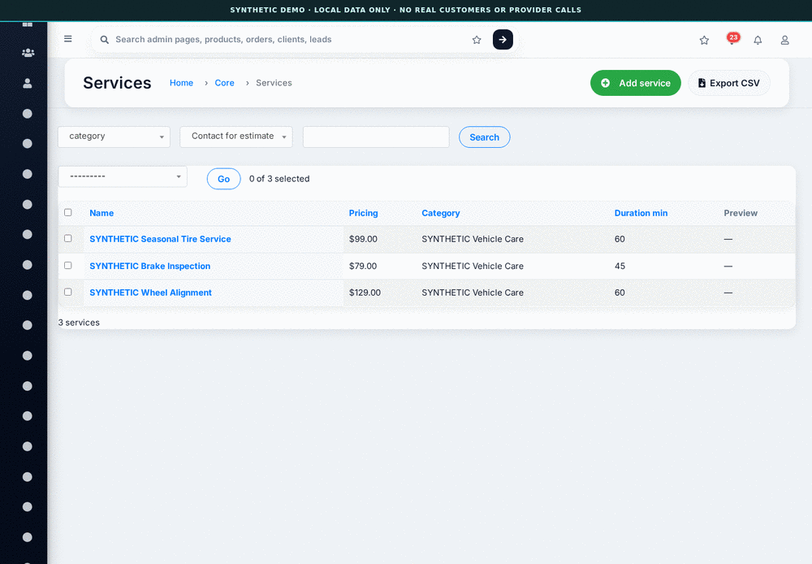
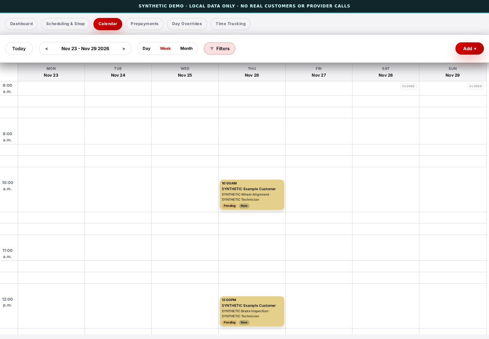
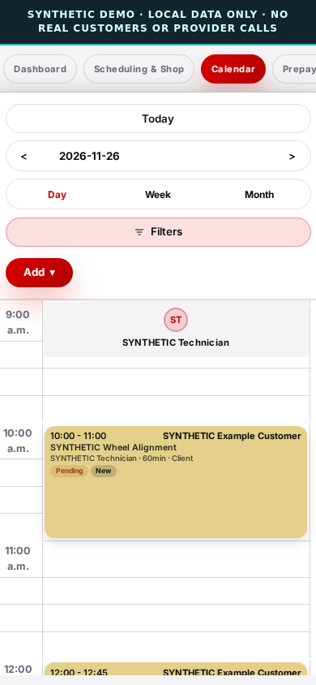

# BGM CRM · synthetic local demo

Actual source views captured on **25 November 2026** from `84dca969c29ebdf1e47ed1bdc449edd3945b09b8` plus standalone showcase settings and fixtures. No application behaviour or production setting was changed for these captures.

**SYNTHETIC DEMO · no real customers, appointments, stock, payments or provider calls.**



| Calendar · desktop | Calendar · mobile |
| --- | --- |
|  |  |

[Service catalogue](assets/showcase/bgm-service-desktop.png) · [Product workspace](assets/showcase/bgm-products-desktop.png) · [Engineering case study](ENGINEERING_CASE_STUDY.md)

## Run it locally

Use a trusted local clone, a Python environment with the project dependencies, and installed PostgreSQL server tools. The demo needs `initdb`, `pg_ctl` and `psycopg2`; it does not connect to an existing PostgreSQL service. Run as your ordinary local user, not root.

```bash
python3 scripts/showcase/run.py --prepare-only
python3 scripts/showcase/run.py --port 3387
```

Each command creates a **new private temporary directory and database cluster**. `--prepare-only` migrates and validates the synthetic fixtures, then stops its own PostgreSQL instance. The second command prepares a separate fresh demo and starts `http://127.0.0.1:3387/admin/`. Sign in as `synthetic-demo`; read the random password from the printed state's `admin-password` file. Press Ctrl+C to stop the server and its owned database cluster.

If PostgreSQL tools are outside PATH, pass `--postgres-bin /path/to/postgresql/bin`. To choose a state location, pass `--state-dir /tmp/bgm-my-demo`; existing paths are refused. All state and logs stay private and outside Git. After an abnormal process termination, stop **only this demo's cluster** with `pg_ctl -D /printed/state/postgres -m fast -w stop` before removing its private files.

The showcase never imports `booking.settings` or production `.env` files. It explicitly selects its new database, uses in-memory email, clears provider credentials, disables geolocation and blocks server-side external connections/DNS. Seeded appointments are model-validated and bulk-inserted without dispatching notification signals. Do not treat this configuration as a production deployment guide.

## What is shown

- Actual day/week staff scheduling, service prices and the catalogue workspace.
- Existing migrations and application model validation against fresh PostgreSQL.
- Synthetic users and reserved example contacts only; no private customer screenshots.
- A GIF sequence of real service → calendar → catalogue views. All frames carry the visible demo label.

The mobile day calendar retains the source's horizontal navigation overflow. No payment, email, Telegram, fulfilment, public booking delivery or business-performance claim is made. Read the [case study](ENGINEERING_CASE_STUDY.md) for the validation and concurrency limits.
