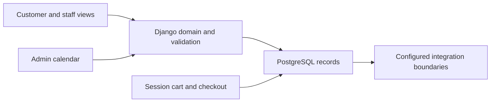

# Engineering case study · BGM CRM

**Scheduling, customer records and a product catalogue share one operational workspace.**
BGM CRM is a Django application with a customised staff calendar, customer-facing account flows and a store. This case studies implemented boundaries in the source, without claiming measured revenue, scale or provider reliability.

[See the synthetic demo](DEMO.md) · [Domain models](../core/models.py) · [Calendar administration](../core/admin.py) · [Store checkout](../store/views.py)

## Problem and constraints

A booking needs a service, a qualified staff assignment, an available time and useful contact details. Staff need day, week and month views rather than raw database rows. Product sales add a different set of concerns: catalogue variants, inventory, shipping, discounts and payment-provider state.

The application must preserve the links between these records while keeping operational integrations configurable. Its PostgreSQL `ArrayField` catalogue data also means that a convincing local demo should use PostgreSQL rather than pretending the complete schema is SQLite-compatible.

## Implementation

- [Domain models](../core/models.py) connect services, staff profiles, customers, appointments, payment statuses and status history. `Appointment.clean()` checks contact details, closure rules, time-off, staff and room overlaps, and shift boundaries.
- [Calendar administration](../core/admin.py) builds day, week and month projections. [The templates](../templates/admin/appointments_calendar.html) and [JavaScript](../static/admin/js/appointments.js) provide navigation, filtering and booking interactions on top of those records.
- Service prices are stored as `DecimalField` values. The existing `Service.base_price_amount()` and discount methods return quantized `Decimal` amounts, while contact-for-estimate services can withhold a fixed public price.
- [The store](../store/models.py) models products, variants and orders. [Checkout](../store/views.py) combines cart validation, shipping rules and the configured payment and fulfilment integrations. Those provider paths were inspected, not exercised in this local showcase.

## Tradeoffs and limits

A Django monolith makes cross-domain staff workflows straightforward, but large model and view modules increase the cost of understanding side effects. Appointment validation is application-level and uses bounded overlap queries; this case does not establish a database-level concurrency guarantee for competing bookings.

Provider calls and notification signals require explicit operational configuration and separate failure-handling tests. The demo deliberately bypasses appointment creation signals during fixture insertion, after running model validation. It therefore demonstrates the staff views and validation path, not email/Telegram delivery or payment execution.

The current admin calendar is more comfortable on a desktop. Its mobile day view remains usable in the captured case, but the horizontal workspace navigation overflows at 390 pixels. The showcase preserves and discloses that limitation rather than changing application CSS to improve a screenshot.

## Verification · 25 November 2026

The repository's migrations completed against a **new isolated PostgreSQL 16 cluster**, bound only to loopback with small memory limits. Three synthetic services, appointments and catalogue products were inserted. Each appointment passed the actual model's `full_clean()` before fixture insertion; the actual service price accessor returned the expected `129.00 CAD` fixture amount.

Authenticated calendar, service and product administration views returned HTTP 200 in the capture pass without browser JavaScript exceptions. The screenshots contain only clearly labelled synthetic identities, reserved example contact data and test prices. The desktop and mobile calendar show the same synthetic booking date.

No existing database, live customer, payment, email provider, Telegram consumer, fulfilment service or deployed application was used. This verifies the demonstrated path; it is not a full application, concurrency, accessibility or security certification. Existing security findings and historical source remain outside the scope of this presentation change; consult [the security policy](../SECURITY.md) before deploying.
